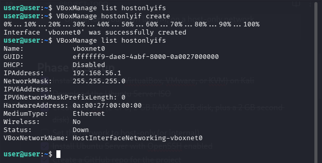
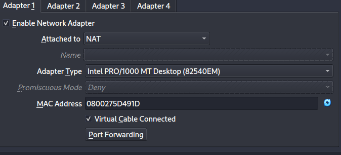
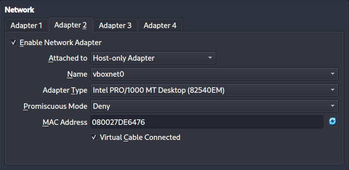
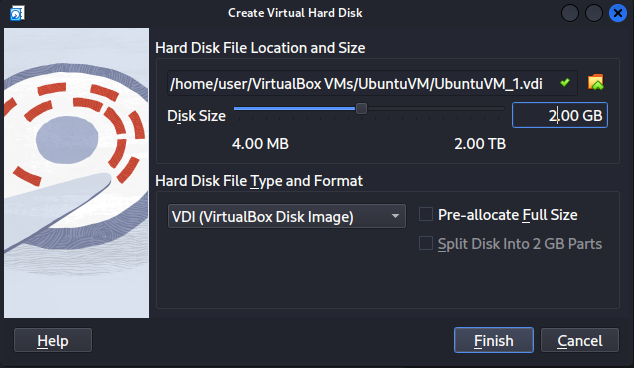
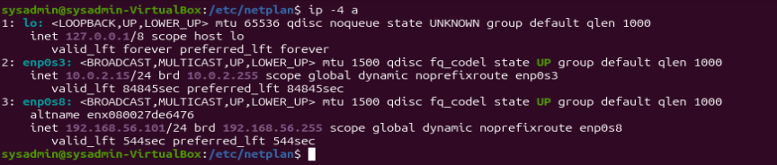
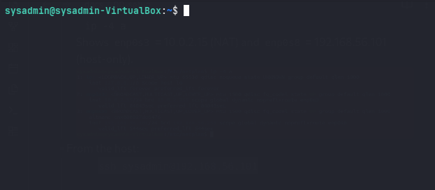
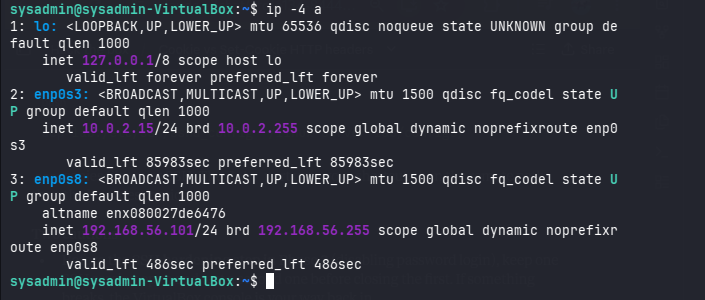

## Goal of phase 00 :
```
- Install and setup ubuntu in the virtualbox
- Add a host-only adapter and a second disk
- setting the ho
```


Host-only adapter and second disk added
## Create a host-only network : 

## the NAT adapter to connecting to the internet 

## add the host-only adapter 


## Add second disk 


## Verification
- Inside the VM: 
	``` ip -4 a ``` 
	Shows `enp0s3` = 10.0.2.15 (NAT) and `enp0s8` = 192.168.56.101 (host-only).
	
- From the host:
	 ```bash
		 ssh sysadmin@192.168.56.101
	 ```
	
	
## Add a shortcut to connect to the lab :
```bash
nano ~/.ssh/config
```
open (creates)  personal SSH settings file :
```nano
Host lab
	HostName 192.168.65.101
	User sysadmin
```
now connecting just using the command :
```bash
 ssh lab
```
